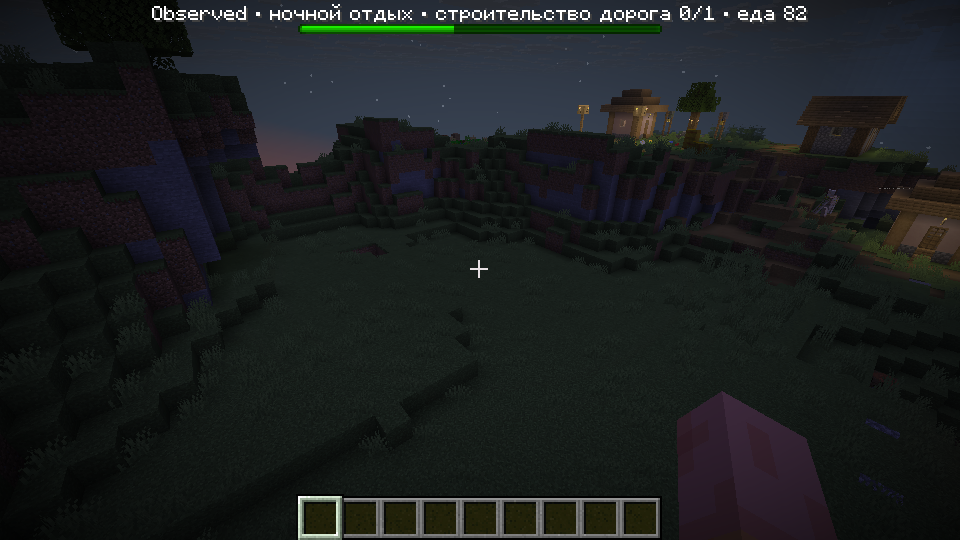

# Мирная приёмка: roadmap 3–10

17 октября 2026 года. Проверки выполняются на **Peaceful**, цель 400 TPS; отдельный контроль — 40 TPS. Это проверка кандидата, а не объявление завершённой автономности.

## Сборка и автоматические проверки

- `gradlew build validationJar clientValidationJar --no-daemon`: успешно; 69 JUnit без провалов.
- Python: 23 теста инструментов хранения, очистки и временных ограничений — PASS.
- Игровой JAR: `1fb2a9d66befae149d6c9d74954977b9e724a5a55e98b1d1fe7fbddcbd0d1330`.
- Navigation AI: `fb6fbe824cb226668d72987c2d45eead13e103ed328b14fe3647a322a0995d44`.

## Реальные серверные сцены

| Проверка | Результат | Доказательство и предел |
|---|---|---|
| Заказы и доставка | 7 PASS, 400 TPS | Реальный резерв, полный рюкзак получателя, передача досок, смерть, частичный и полный возврат настоящего дропа. |
| Жильё и склад | 7 PASS, 400 TPS | Оплаченные подходы, рабочая база склада до крыши, приоритет ремонта и жилья; физический дом с двумя кроватями. Материалы и позиции предоставлены сценой. |
| Постоянные роли | 8 PASS, 400 TPS | Семь родных профессий, помощь фермера и возврат к урожаю, носильщик, сторож, состав дома при вылазке, смерть без перестановки остальных ролей. |
| Железо, собственное стадо и кровати | 9 PASS, 400 TPS | Настоящие руда, износ, печь, передача слитков, ножницы и следующая кирка; оплаченный загон, привод двух овец через калитку, две настоящие пшеницы, нативный ягнёнок; шерсть физически передана изготовителю и установлены две кровати. Следующая заявка использовала тех же родителей. |
| Поля, мастерские, правила, преемник | 10 PASS, 400 TPS до расширения сцены | Реальная срезка и дроп, ведро за три слитка, забор и перенос источника, 20 обработанных орошаемых клеток, семенной резерв, выпуск досок/хлеба/железа, запрет библиотечной добычи, граничный личный сундук, принятие изменений дома, преемник и выпавшее железо. |
| Мост, пост и лес | 13 PASS до ошибки рождения, 400 TPS | Дополнительно житель физически прошёл оплаченный мост над двумя клетками воды; три клетки отвергнуты. Сторож дошёл на настоящий пост. Реально срублены три бревна, списан саженец, участок отдыхает и выбирается следующий участок с деревьями. Выполнены protect/unprotect/expansion/orders. |
| Контроль и сохранение | 11 PASS + 1 PASS перезапуска, 40 TPS | Базовая сцена и сохранение снимка; процесс сервера остановлен и запущен заново на том же одноразовом мире. Сверены полный состав живых жителей, роли, участки, правила, планы, выпуск и реальные предметы/износ рюкзака. |
| Рождение и взросление | **FAIL / не достигнуто** | После оплаченного жилья и выдачи настоящего хлеба ребёнок не появился за ограниченный срок. Повтор с явным выбором пары через нативное VillagerMakeLove также израсходовал хлеб без ребёнка. Причина доступности/занятости кроватей требует отдельной диагностики. Взросление 24 000 тиков и последующее назначение работника не подтверждены. |

У овец поедание настоящей травы запускалось нативным EatBlockGoal в сцене, чтобы не ждать случайного выпаса. Частота самостоятельного отрастания шерсти не засчитана. Новая кирка оплачена тремя предоставленными сценой слитками; ножницы — двумя реально добытыми и выплавленными. Исходные овцы созданы вне загона; после этого животные не телепортировались.

Серверные сцены изолируют материалы и позиции. Они не доказывают самостоятельный поиск всех ресурсов, строительство всего хозяйства с нуля или общую устойчивую логистику. Оборона от монстров и тревога в этом мирном наборе не проверялись.

Результаты с ID и SHA-256: [focused-results.json](focused-results.json). Производство: [production-events.log](production-events.log). Расширенная сцена, включая провал рождения: [systems-events.log](systems-events.log).

## Общие клиентские прогоны

Команда обоих:

```text
python tools/client-validation/run.py --colony --growth --tick-rate 400 --max-ticks 144000
```

Без `--live-threats`: Peaceful, естественные сутки и погода, реальный клиент с копией обычного профиля, seed 8675309. Предметы и производственные постройки не выдаются. Оригинальные профиль и миры не изменяются.

Первый: `client-20261017-101837-531283`, старый игровой JAR `7eca3e...`. Достигнуты 144 000 тиков, все шесть жителей живы, запас еды вырос с 6 до 70. Последний замер 400,14 TPS, средний 396,35. Зафиксированы 60 000 ночных тиков, 71 619 тиков с наблюдаемым сном. **FAIL хозяйственного роста:** новых домов/полей/мастерских нет, подтверждённых шахтёрских доставок нет, ножниц/шерсти нет. [Полный последний снимок](peaceful-before-fix.json).

Исправление между прогонами: Infrastructure больше не использует занятый блок сундука под крышей как единственное начало дороги. Выбирается действительная проходимая точка у известного входа; учитывается настоящая высота грунта у пока не построенного склада. Существующие ступени не требуют повторного срезания природного грунта. Ограничения расстояния, пролёта и оплаты сохранены. Отдельная сцена с внутренним сундуком подтвердила подготовку подхода.

Итоговый прогон: `client-20261017-103916-263313`, **FAIL: production_observation_timeout**. Наблюдение достигло 144 000 тиков; остановка записана на 144 001. Все шесть жителей имеют 20 HP, запас еды вырос с 6 до 82. Цель 400 TPS: последний замер 399,75, средний с разгоном 395,80. Исходники не менялись: `sourcesUnchanged=true`. Клиент завершён штатно; exitCode=0 не выдаётся за успешную игровую приёмку.

После исправления начали появляться реальные планы и оплаченные дороги: 3/7, 1/9, 2/7 и 0/1 блоков. Склад 0/161, дом 0/85, поле 0/3, загон 0/24. Размечено поле и 14 лесных участков, наблюдались две вырубки и две посадки. Заказ досок дошёл до 6/6; шерсть 0/6, ножницы 0/1, железо 0/2. Новых подтверждённых шахтёрских доставок нет, стадо пустое. В общем запасе 134 булыжника, из них 34 в общем сундуке; наличие материала само по себе не завершило подходы. К 64 000-му тику дороги достигли указанных значений и до конца наблюдения не продвинулись.

Таким образом, исправлена исходная остановка планирования, но сохраняется остановка исполнения/снабжения дорог, из-за которой зависимые здания не начинают строиться. Полная деревня не принята даже без монстров. Второй такой же длинный повтор не запускался.

[Итоговые числа и исполнители](colony-result.json) · [Полный последний снимок](peaceful-after-fix.json)



В контроле перезапуска зарегистрировано отдельное ERROR восстановления одного контроллера: `Expected a live, loaded villager on this server`. Ожидаемый живой состав и его рюкзак восстановились точно, поэтому узкая проверка сохранности PASS; журнал не объявляется чистым. Требуется отдельная проверка обработки уже умерших/не загруженных тел. [События перезапуска](restart-events.log).

Полного парного мирного наблюдения при 40 TPS не было; короткий контроль и одинаковая скорость обработки не доказывают эквивалентность всего поведения на разных частотах.

## Найденные проблемы самих сцен

- Наблюдатель spectator не обеспечивал загрузку жителей после переноса к найденной деревне. Используется летающий creative-наблюдатель, сложность задаётся независимо; перед claim проверяется загрузка настоящих жителей. Зафиксирован полный исходный состав из шести человек.
- Старый тест заказов не включал новую очередь IronSupply и отключал всех подходящих исполнителей через NoAI; обновлён состав и вызов очереди.
- Стоявший рядом сторож подбирал руду шахтёра. В производственной сцене рабочие места разнесены; предметы не добавлялись вместо потерянных.
- В сцене жилья подход также строится с оплатой, прежде чем ожидать дом.
- Общая плоская сцена имеет один слой травы над исходным рельефом. Под отверстием орошения добавлено настоящее основание, чтобы выкопанная земля не падала под лабораторию.
- Временной предел производства теперь ограничивает каждый этап и весь цикл; прежние 4200 тиков на всю цепочку обрывали доставку шерсти после успешного размножения. Критерии предметов, рождения, навигации и оплаты не ослаблены.

Все запуски последовательны, через общий lock и штатную очистку лабораторий. Журналы сохранены компактно. Повторяющийся провал рождения оставлен FAIL; дальнейшие одинаковые попытки остановлены.

## Что остаётся открытым

1. Доведение подходов до готовности и снабжение зависимых дома, поля и загона в обычной деревне.
2. Самостоятельная шахтёрская доставка, изготовление ножниц и шерсть в общем цикле, при пройденной изолированной производственной цепочке.
3. Нативное рождение и естественное взросление нового работника: сценарий рождения FAIL; причина не локализована. Это не доказательство конкретной ошибки PopulationPlanning, а непройденная игровая приёмка.
4. Оборона и тревога требуют отдельной проверки с угрозами; мирный прогон не служит такой проверкой.

Одноразовые лаборатории после завершения: client 0 байт, server 0 байт. Gradle сообщил, что работающих daemon-процессов нет. Новые длительные прогоны без отдельной гипотезы не запускались.
