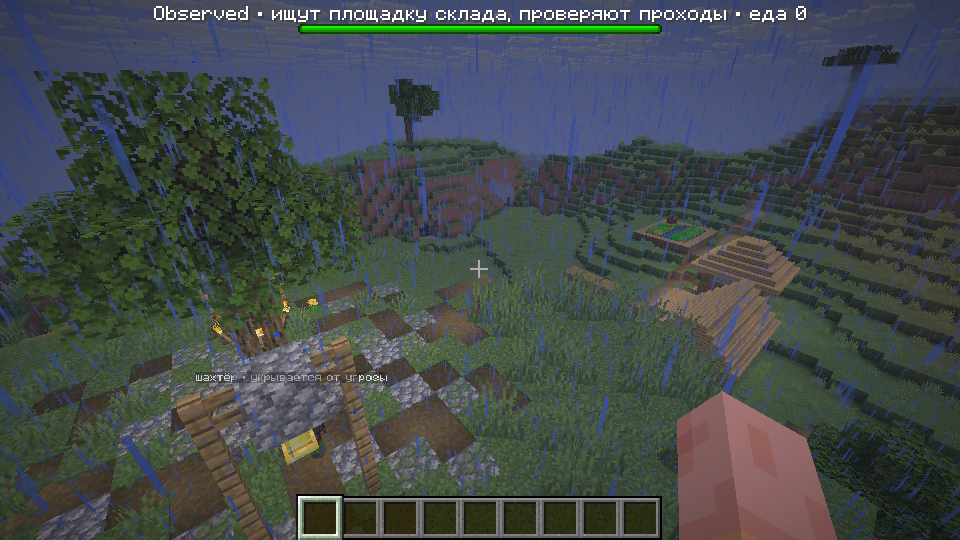

# Roadmap 6–10: ревью, исправления и проверка в игре

17 октября 2026 года. **Полная автономность не принята.** Реализация проверена
модульно и в целевой серверной сцене; единственный общий клиентский сценарий
завершился гибелью жителей. Не выдавать эту сборку за готовую автономную деревню.

## Ревью и исправления

[Read-only ревью и последующие исправления](REVIEW.md) выполнены до общего прогона.
Исправлены запреты вспомогательной добычи, зависимость земляных работ от дороги,
ротация пустого лесного участка, сохранение граничного личного сундука, учёт
неудач подхода и принятие неполной пары двери/кровати. Игровая проверка дополнительно
выявила конфликт дороги с будущим полом и смешение основной роли с временной
помощью при заказе ведра и выборе мастерской; эти проблемы исправлены.

## Что прошло

- Сборка успешна. 69 JUnit, 0 провалов/ошибок.
- Целевая серверная сцена при цели **400 TPS — 9 PASS**.
- Та же сцена на тех же игровых и проверочных JAR при **40 TPS — 9 PASS**.
- Проверены реальные списания материалов/дроп, орошение ведром, семенной фонд,
  оплаченные мастерские и их выпуск, запреты/команды, выдача хлеба паре при
  обеспеченном росте, преемник и учёт выпавших вещей.
- Сцена предоставляет материалы и позиции. Самостоятельная заготовка, навигация,
  размножение жителей, воспроизводимая шерсть и мостики ею целиком не подтверждены.

Попытки, результаты и хеши: [focused-results.json](focused-results.json).

## Общий клиентский сценарий 400 TPS

Команда:

```text
python tools/client-validation/run.py --colony --growth --live-threats --tick-rate 400 --max-ticks 144000
```

ID: `client-20261017-064245-565517`. Настоящий клиент в копии обычного профиля,
seed 8675309, Normal, естественные сутки/погода/монстры, без выдачи предметов и
производственных фикстур. Исходные профили/сохранения не изменялись.
**Исходники оставались неизменными в течение наблюдения: sourcesUnchanged=true.**

Результат: **FAIL, resident_lost_during_live_observation, тик 29 670**.
Предельные 144 000 тиков не достигнуты. Клиент завершился штатно (exitCode=0),
это не успех игровой приёмки. Последняя частота 399,31 TPS, средняя с разгоном
378,63 TPS; последний meanTickMs 1,236. Причинная связь провала с частотой
не установлена: полноценного парного общего 40-TPS прогона не было.

В последнем снимке, тик 29 600:

- 4 исходных дома; новых домов, складов, полей и мастерских нет.
- Зарегистрировано 13 лесных участков; наблюдались одна вырубка и одна посадка.
- Новых подтверждённых шахтёрских доставок 0, шерсти 0, ножницы не наблюдались.
- Оставшиеся два работника ранены (11 и 8 HP), пытаются добраться домой,
  в родных инвентарях еды нет. Повторяется «нет безопасного подхода».
- До этого зафиксировано 10 000 ночных тиков и 11 675 тиков с хотя бы одним
  спящим жителем. Это не доказывает безопасность остальных.

В серверном журнале шесть сообщений о гибели: строитель, фермер, шахтёр,
сторож, лесоруб и завхоз. Пять убиты зомби; лесоруб — противником, унаследовавшим
имя шахтёра (обращённым соседом). Последний исходный житель погиб вдали от
выбранной кровати. Точный источник непройденного подхода требует отдельной
ограниченной сцены; менять скорость, смертность или критерии приёмки ради PASS
нельзя. Планировщик также не смог начать новую стройку на данном рельефе.

[Числа и события](colony-result.json) · [короткий журнал](colony-events.log)



## Обнаруженная ошибка наблюдателя

При постепенной загрузке чанков `initialResidents` записался как 1, хотя к
проверке охвата присутствовали 6 жителей. Поэтому критерий потери отслеживал
только первого и не остановил опыт на более ранней смерти строителя.
После завершения опыта наблюдатель исправлен: исходный состав замораживается
по полному проверенному охвату при ticks>400. Исправленный проверочный JAR
скомпилирован; общий опыт с ним не повторялся. Игровой JAR не менялся.
Историческое значение initialResidents=1 в JSON сохранено, не переписано задним числом.

## Кандидат и дальнейшие границы

Игровой JAR `build/libs/autonomous-villages-0.2.1.jar`:
`7eca3e67346793ac755fdb7c0ba14f2a51f741321ee78814beee4f8d08891e05`.
Navigation AI: `fb6fbe824cb226668d72987c2d45eead13e103ed328b14fe3647a322a0995d44`.
Полный опыт использовал клиентскую проверку
`76c203cc6ad76a7d8addea7346eae95a1d5a20823bb506ae421c26d51a5cc8ee`;
новый наблюдатель после исправления учёта не является повторной приёмкой.

Длинный сценарий запускался один раз и не повторяется без новой гипотезы.
Следующие конкретные блокеры: физический доступ в исходные укрытия и доступное
планирование площадки/подхода на рельефе этой деревни. Пункты 1, 2, 5 остаются
открытыми; полная приёмка 6–10 также не пройдена. Подтверждённая скорость сама
по себе не закрывает хозяйственные и защитные требования.
